# Tazumo

Europe-first, multi-category delivery marketplace. **Working three-platform prototype, not a live ordering service.**

**Web preview:** https://wopee-io-demos.github.io/tazumo/ (synthetic demo data, no real orders, payments or delivery). Deployed from `main` by [`pages.yml`](.github/workflows/pages.yml), which smoke-tests the live URL after every deploy.

## Packages
- `apps/web`: React/Vite responsive marketplace with Playwright-tested category, search, cart and palette changes.
- `apps/mobile`: Expo React Native iOS/Android app. Both debug Android APK and iOS Simulator .app compile.
- `packages/core`: shared typed catalogue/cart functions.
- `packages/brand`: independent branding and color palettes.
- `openspec/`: requirements and implementation tasks.
- `docs/adr/`: architecture decisions.

## Quickstart
Node 22, pnpm 10.
```sh
corepack enable
pnpm install
pnpm dev:web
pnpm dev:mobile
pnpm typecheck
pnpm test
pnpm build
pnpm bundle:mobile
pnpm exec playwright install chromium
pnpm test:e2e
```

## Verified
- [Web tests + builds](https://github.com/wopee-io-demos/tazumo/actions/runs/44767554583), green.
- [Android debug APK and iOS Simulator app](https://github.com/wopee-io-demos/tazumo/actions/runs/44767543758), green. Development artifacts expire November 27, 2026.

Not verified: native device launch, signed distribution. No accounts, real merchant inventory, payments, courier tracking, or production checkout. Catalogue/prices are illustrative. Trademark, domain and mascot rights not cleared.

## Screenshots

SUT reference imagery captured from the real app. These are not Wopee or Appium test verdicts. The gallery reflects the SUT commit stated below; the UI keeps changing, so regenerate it with the command in the table rather than editing images by hand.

### Web

| | Desktop 1440x900 | Mobile 390x844 |
| --- | --- | --- |
| Catalogue | 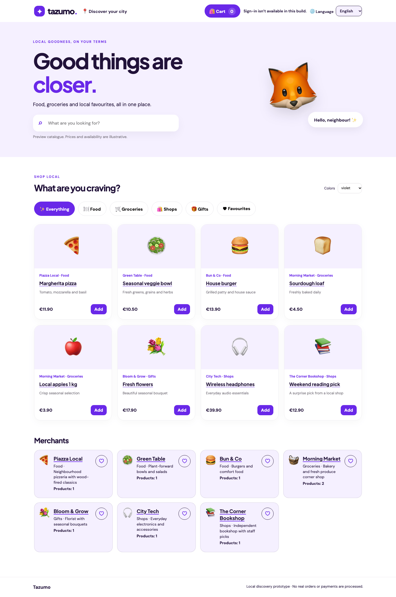 | 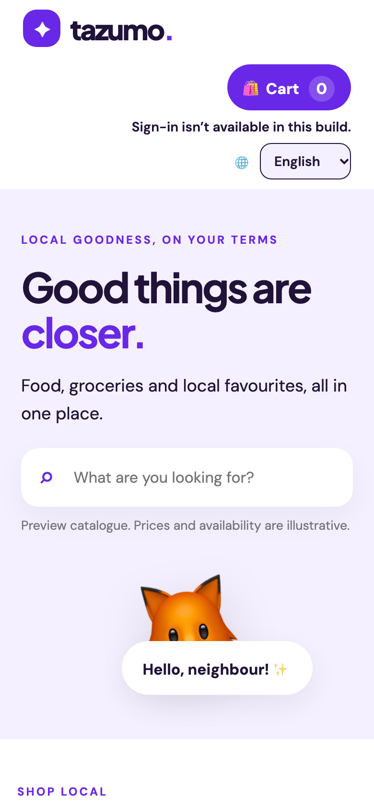 |
| Category: Groceries | 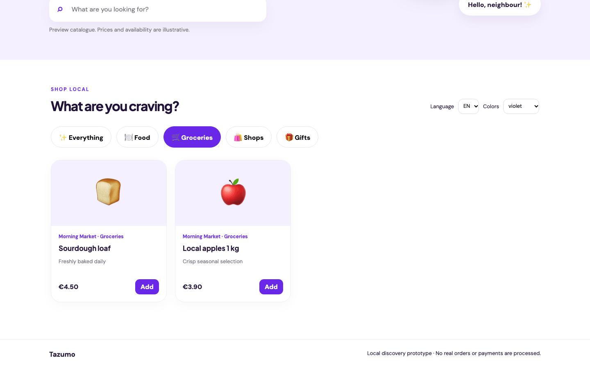 | 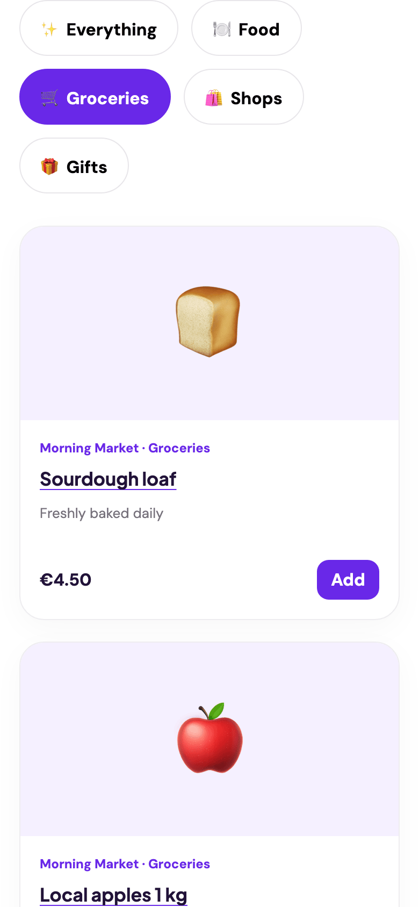 |
| Search: "fresh" | 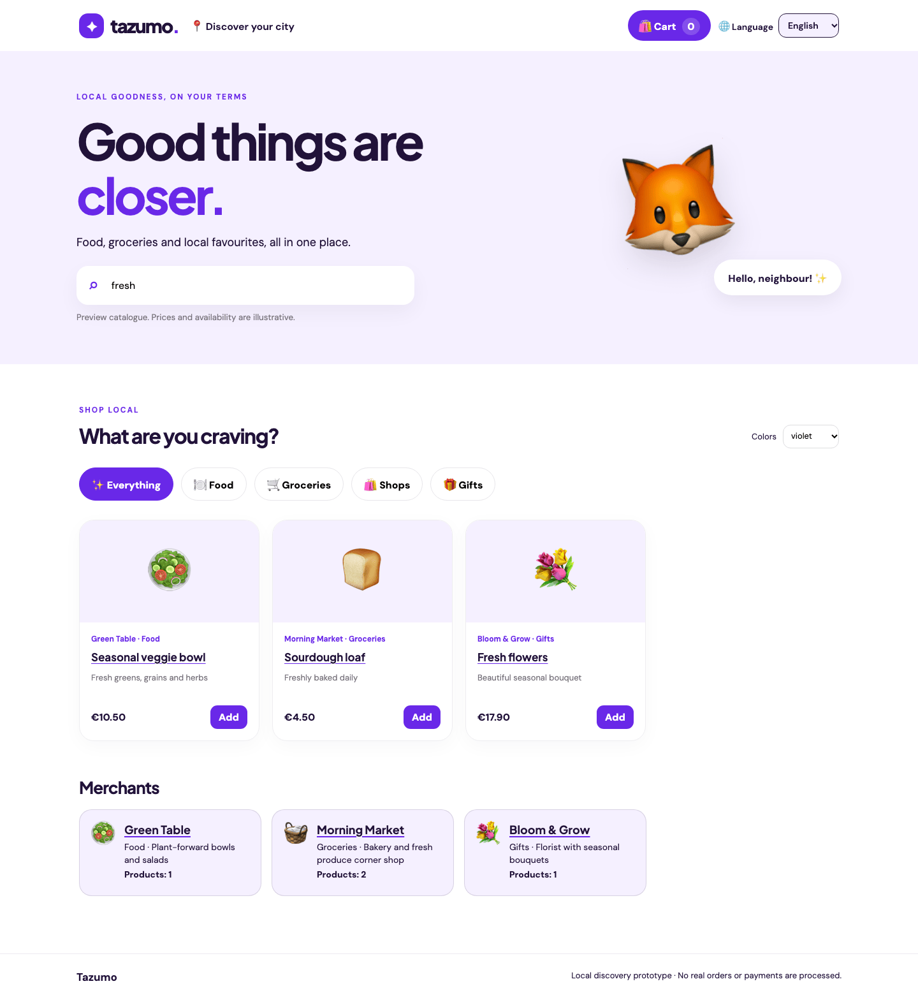 | 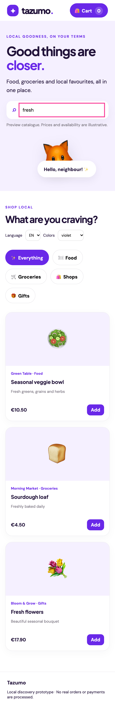 |
| Cart with items | 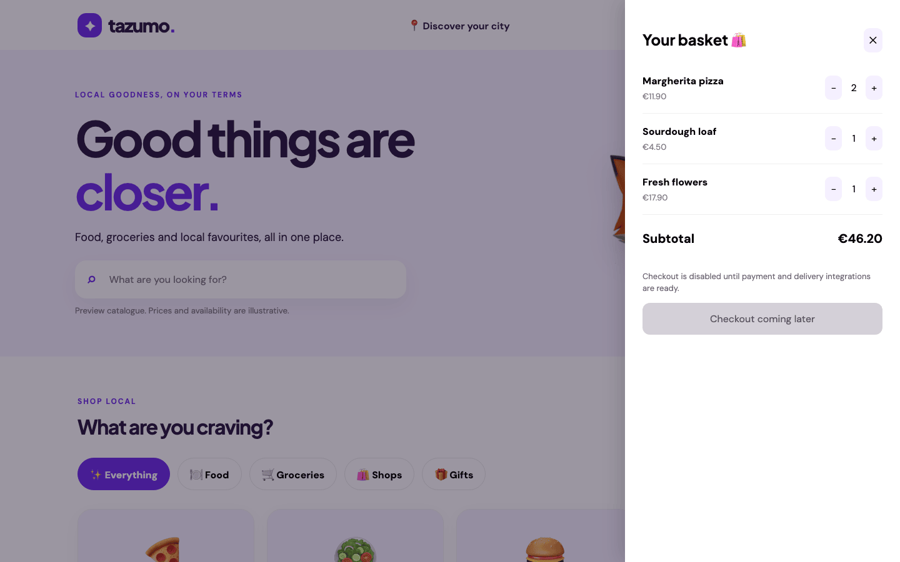 | 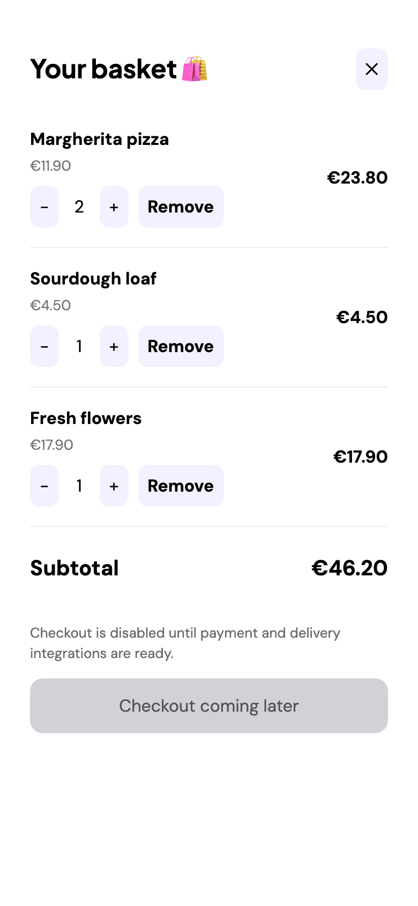 |
| Merchant detail | 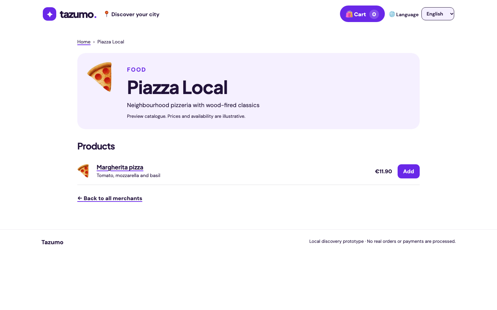 | 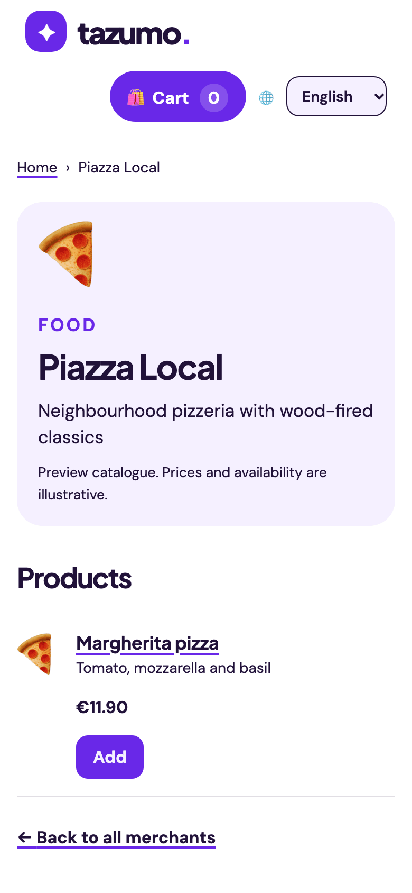 |
| Product detail | 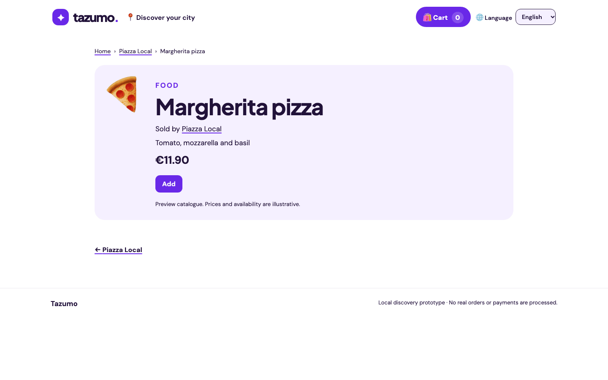 | 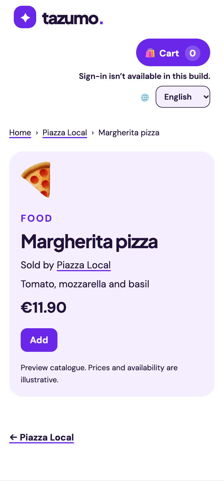 |

| Provenance | Web |
| --- | --- |
| SUT commit | [`be970e2`](https://github.com/wopee-io-demos/tazumo/commit/be970e26633469e94876c5740051fcb1ed082179), the last change to `apps/web`, `packages` and workspace config at capture time |
| Fixture data | Synthetic catalogue and merchants in `packages/core`; cart = 2x Margherita pizza, 1x Sourdough loaf, 1x Fresh flowers; detail pages for `piazza-local` and `pizza` |
| Capture command | `bash scripts/capture-web-screenshots.sh` after `pnpm install` and `pnpm exec playwright install chromium`; needs `pngquant` and network access for Google Fonts. It runs `pnpm build`, serves `vite preview`, runs `tests/screenshots/capture.spec.ts` and replaces the gallery only when every capture passes |
| Browser | Playwright 1.65.1, Chromium 159.0.8154.6, macOS arm64 host |
| Viewports | Desktop 1440x900 @1x; mobile 390x844 @2x with touch |
| Determinism | App language EN, locale en-IE, timezone Europe/Prague, light scheme, reduced motion, fixed clock, animations and caret disabled; a capture fails on page or console errors or missing web fonts; repeat runs are byte-identical on the same host |
| Optimiser | pngquant 3.0.3 |
| Captured | 2026-11-21 ([`provenance.json`](docs/screenshots/web/provenance.json)) |

### iOS and Android

| | iOS simulator | Android emulator |
| --- | --- | --- |
| Catalogue | 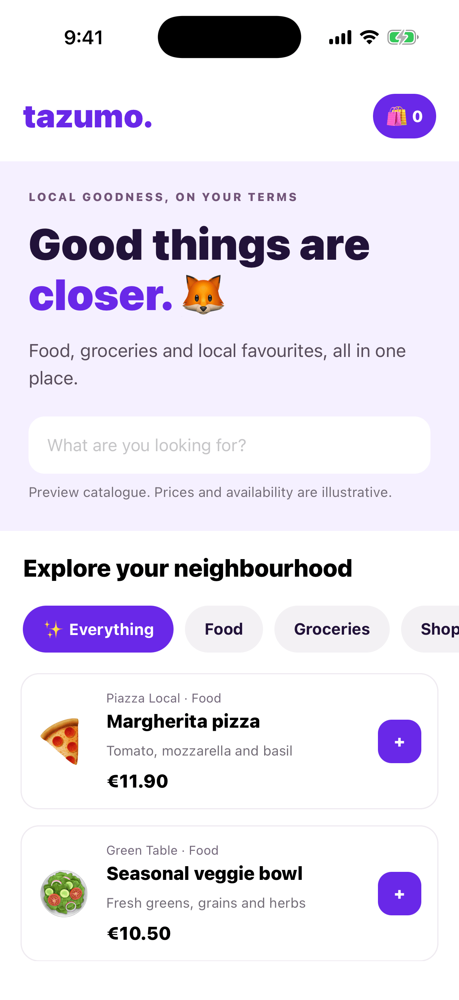 | 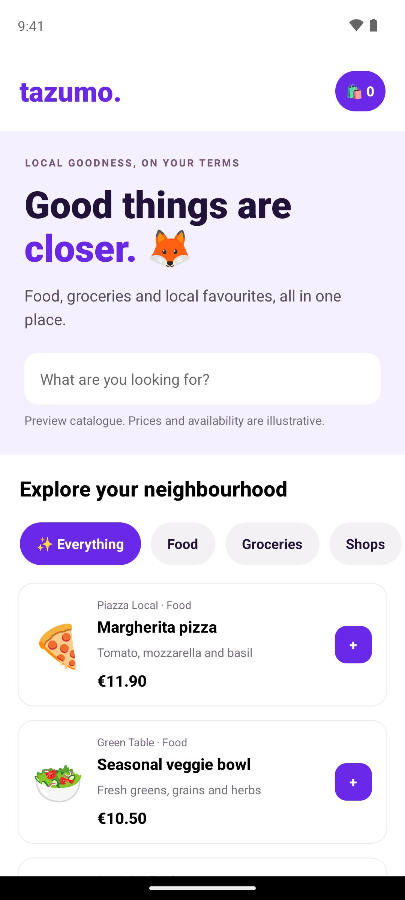 |
| Product screen | not captured yet (see below) | 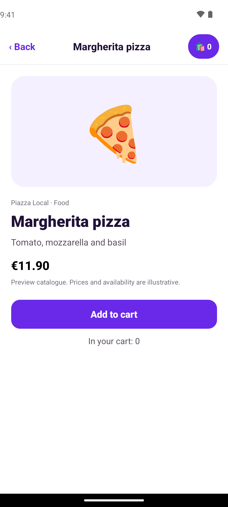 |
| Inline basket | 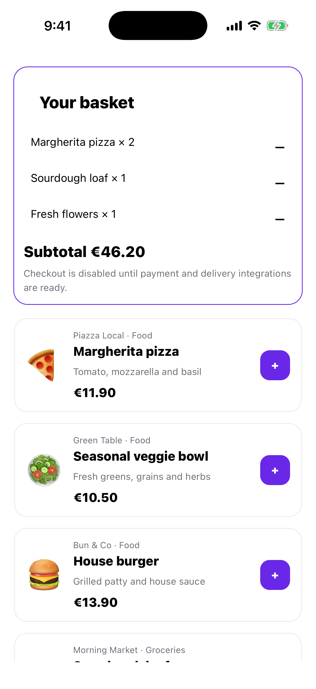 | 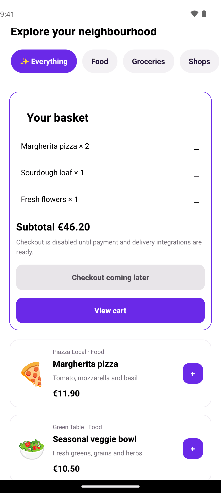 |
| Cart screen | not captured yet (see below) | 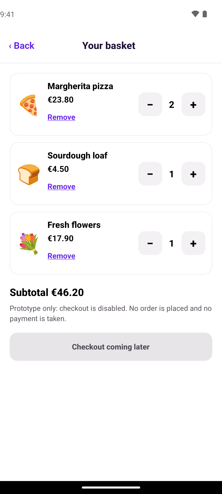 |

| Provenance | iOS | Android |
| --- | --- | --- |
| Workflow run | [SUT screenshots #44817080915](https://github.com/wopee-io-demos/tazumo/actions/runs/44817080915) | [SUT screenshots #44902715301](https://github.com/wopee-io-demos/tazumo/actions/runs/44902715301) |
| SUT commit | [`3354ab6`](https://github.com/wopee-io-demos/tazumo/commit/3354ab63930c56ff8fb138e55c1682c54029a04c), before the native product and cart screens (#45) | [`be970e2`](https://github.com/wopee-io-demos/tazumo/commit/be970e26633469e94876c5740051fcb1ed082179) (last change to `apps/mobile`, `packages`, workspace config at capture time) |
| Capture commit | `b925225` on the [#57](https://github.com/wopee-io-demos/tazumo/pull/57) branch | `7e629c3` on the [#127](https://github.com/wopee-io-demos/tazumo/pull/127) branch |
| Build | Release `iphonesimulator` build with the JS bundle embedded, unsigned | Release-variant APK with the JS bundle embedded, signed with the debug keystore, x86_64 |
| Device | iPhone 16 Pro simulator on the iOS 26.2 runtime, Xcode 16.4 (iPhoneSimulator 18.5 SDK), hosted `macos-15` | `sdk_gphone64_x86_64` emulator, Android 14 (API 34), hosted `ubuntu-latest` with KVM |
| Capture | `xcrun simctl io screenshot`; taps by Maestro 1.41.0 | `adb exec-out screencap -p`; taps by Maestro 1.41.0 |
| Fixture data | Same synthetic catalogue and cart as the web gallery | same, plus the Margherita pizza product screen |
| Captured | 2026-11-20 ([`provenance.json`](docs/screenshots/ios/provenance.json), [`SHA256SUMS`](docs/screenshots/ios/SHA256SUMS)) | 2026-11-21 ([`provenance.json`](docs/screenshots/android/provenance.json), [`SHA256SUMS`](docs/screenshots/android/SHA256SUMS)) |

The iOS gallery still shows the app before #45. iOS captures no longer run on pull requests: they run on `main`, nightly and on dispatch. On the iOS 27 simulator the app currently crashes at launch because it does not adopt the UIScene lifecycle ([#171](https://github.com/wopee-io-demos/tazumo/issues/171)). The iOS product-screen and cart-screen captures will be added from the first green iOS run after [#172](https://github.com/wopee-io-demos/tazumo/pull/172) pins the capture to an iOS 26.x runtime.

The PNGs and `provenance.json` in each platform folder are the exact files from that platform's artifact (`tazumo-screenshots-ios` or `tazumo-screenshots-android`) of the run named in the table; iOS and Android can come from different runs. They were optimised in CI with pngquant. `SHA256SUMS` was computed from the downloaded artifact, so the match stays checkable after the artifacts expire; newer runs also write the checksums into `provenance.json`.

To regenerate, use the [SUT screenshots workflow](.github/workflows/screenshots.yml). Android runs on pushes to `main` that match the workflow's path filter, nightly, on `workflow_dispatch`, and on pull requests that touch `apps/mobile/**`, `tests/screenshots/native/**`, `.github/workflows/screenshots.yml` or `tests/screenshots/scope.sh`. iOS never runs on pull requests: it runs on pushes to `main` that match the path filter, nightly and on `workflow_dispatch`, so take iOS from one of those runs. For each platform whose artifact the run has (the steps are chained so a failed download leaves the gallery untouched):

```sh
p=android   # or ios
run=<run-id>
tmp="$(mktemp -d)" &&
gh run download "$run" -n "tazumo-screenshots-$p" -D "$tmp" &&
rm -f docs/screenshots/$p/*.png docs/screenshots/$p/provenance.json docs/screenshots/$p/SHA256SUMS &&
cp "$tmp"/* docs/screenshots/$p/ &&
(cd docs/screenshots/$p && shasum -a 256 *.png > SHA256SUMS)
```

Release builds are used because debug builds need a running Metro dev server.

## Delivery governance
[GitHub Issues backlog](https://github.com/wopee-io-demos/tazumo/issues) is the operational tracker. Changes require issue, OpenSpec and, when relevant, ADR. Read [PR quality and merge policy](docs/PR-QUALITY.md).

## Fresh-start and parallel-agent navigation

**New agent?** Start with [docs/START-HERE.md](docs/START-HERE.md) and the [issue status, claiming and handoff workflow](docs/ISSUE-WORKFLOW.md). The [issue board](https://github.com/wopee-io-demos/tazumo/issues) is live status, not this README. Initialize `status:*` labels with `bash scripts/issue-status.sh bootstrap` once using `gh` with repository administration rights. Re-read claimed issue + open PRs before editing.

## Agent collaboration
[Fresh start](docs/START-HERE.md) · [Shared engineering policy](docs/ENGINEERING-POLICY.md) · [Issue lifecycle](docs/ISSUE-WORKFLOW.md). Live Issues and PRs, not this README, define progress.

## Organization-wide demo program

Start with the [five-repository demo program map](docs/DEMO-PROGRAM.md) for Tazumo, Wopee hosted web, Playwright CLI, Appium, and shared Agent Skills. The current issue labels are already in use; `bootstrap` is needed only if labels are missing. A new agent can run `bash scripts/issue-status.sh audit` (read-only) to identify contradictory issue states before claiming work.
